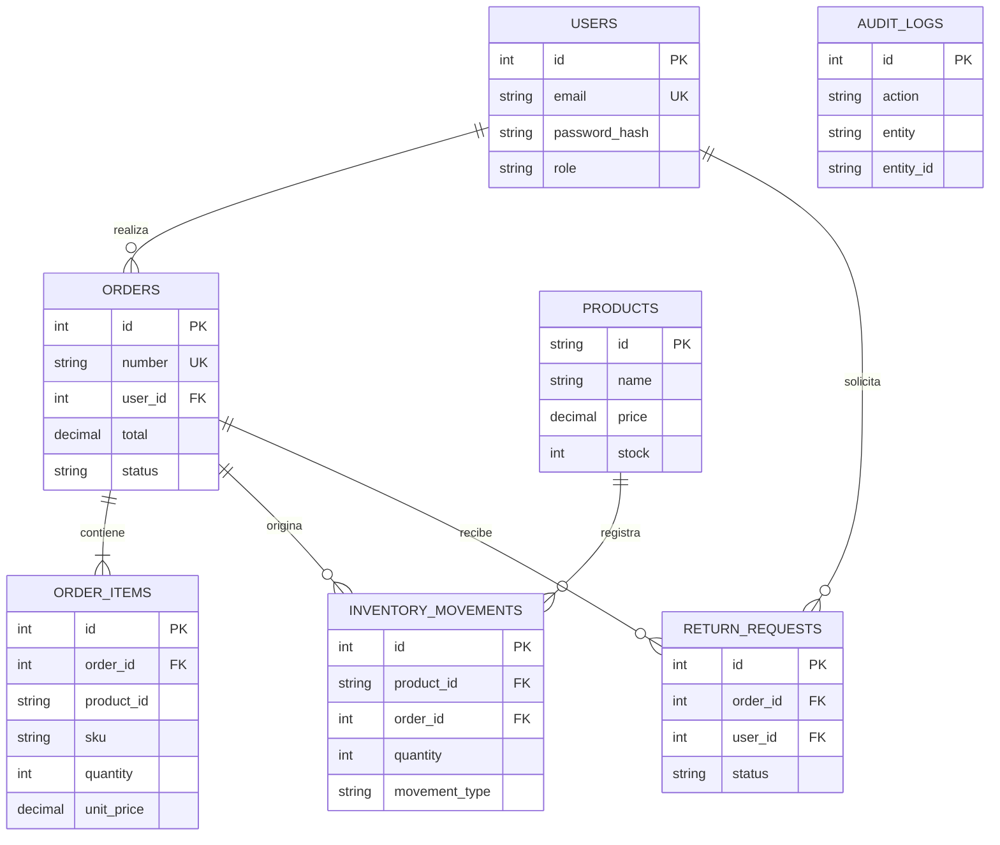

# Base de datos, diccionario y relaciones

Motor: SQLite. El esquema se crea automáticamente al iniciar `server.js`. El script equivalente se encuentra en `database/schema.sql`.

## Diccionario de datos

| Tabla | Campo principal | Tipo | Restricción / descripción |
|---|---|---|---|
| users | id | INTEGER | PK autoincremental |
| users | email | TEXT | Único; correo de acceso |
| users | password_hash | TEXT | Hash bcrypt; nunca contraseña legible |
| users | role | TEXT | customer o admin |
| products | id | TEXT | PK/SKU del catálogo |
| products | price | REAL | Precio base no negativo |
| products | discount | REAL | Porcentaje de descuento |
| products | stock | INTEGER | Existencia no negativa |
| orders | id | INTEGER | PK |
| orders | number | TEXT | Folio único |
| orders | user_id | INTEGER | FK a users |
| orders | status | TEXT | Estado operativo del pedido |
| orders | subtotal/tax/shipping/total | REAL | Importes históricos |
| orders | accepted_terms | INTEGER | Evidencia de aceptación |
| orders | terms_version | TEXT | Versión aceptada |
| order_items | order_id | INTEGER | FK a orders |
| order_items | product_id | TEXT | Identificador de producto |
| order_items | quantity | INTEGER | Unidades compradas |
| order_items | unit_price | REAL | Precio histórico unitario |
| inventory_movements | product_id | TEXT | FK a products |
| inventory_movements | movement_type | TEXT | salida, entrada o ajuste |
| inventory_movements | quantity | INTEGER | Unidades del movimiento |
| return_requests | order_id | INTEGER | FK a orders |
| return_requests | user_id | INTEGER | FK a users |
| return_requests | status | TEXT | Estado de atención |
| audit_logs | user_id | INTEGER | Actor de la operación |
| audit_logs | action/entity | TEXT | Acción y entidad afectada |

## Relaciones
- users 1:N orders
- orders 1:N order_items
- products 1:N inventory_movements
- orders 1:N inventory_movements (referencia opcional al pedido)
- users 1:N return_requests
- orders 1:N return_requests

## Diagrama ER (Mermaid)

## Integridad
Claves primarias, correo y folio únicos, claves foráneas, restricciones de stock/precio no negativos e índices para consultas de pedidos por usuario/estado y productos por categoría. La creación del pedido se ejecuta dentro de una transacción.
