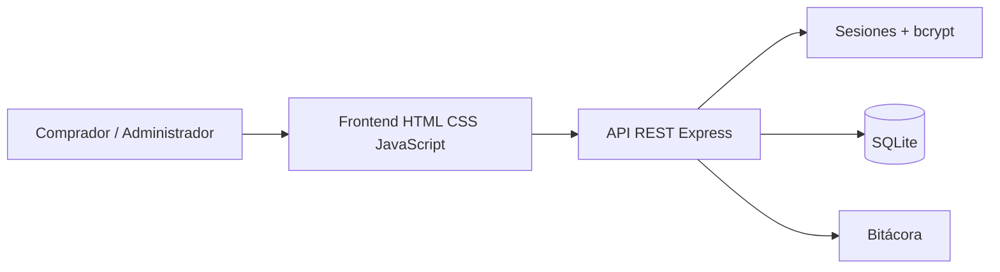

# Arquitectura y decisiones técnicas

## Componentes
- Navegador: catálogo, fichas, carrito, checkout, perfil, panel.
- Express: autenticación, autorización, catálogo, pedidos, inventario, devoluciones y administración.
- SQLite: usuarios, productos, pedidos, partidas, movimientos, devoluciones y auditoría.
- Catálogo semilla: `data_products.json`.

## Decisiones
Se eligió SQLite por facilidad de instalación y demostración en un proyecto académico. Para concurrencia alta o producción se recomienda un SGBD cliente-servidor administrado y una estrategia de migraciones.
El backend recalcula importes y existencias; el navegador solo presenta una estimación.
El flujo de pedido usa transacción para evitar pedidos incompletos y stock negativo.

## Despliegue
La aplicación debe publicarse en un servidor Node.js con disco persistente y HTTPS. GitHub Pages no puede ejecutar backend ni SQLite. Si se separan frontend y API, se requiere configurar CORS, dominio de cookies, `Secure`, CSRF y orígenes permitidos; no basta con cambiar la URL del fetch.
