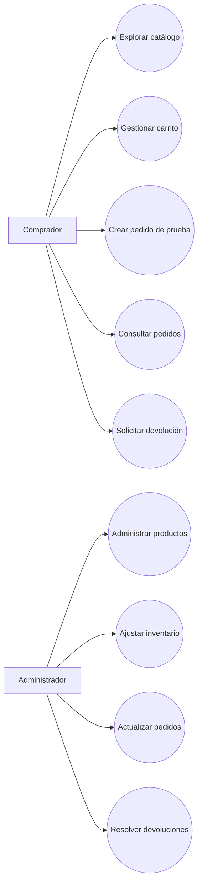
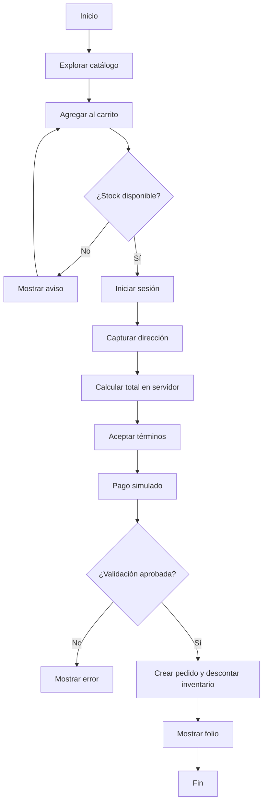
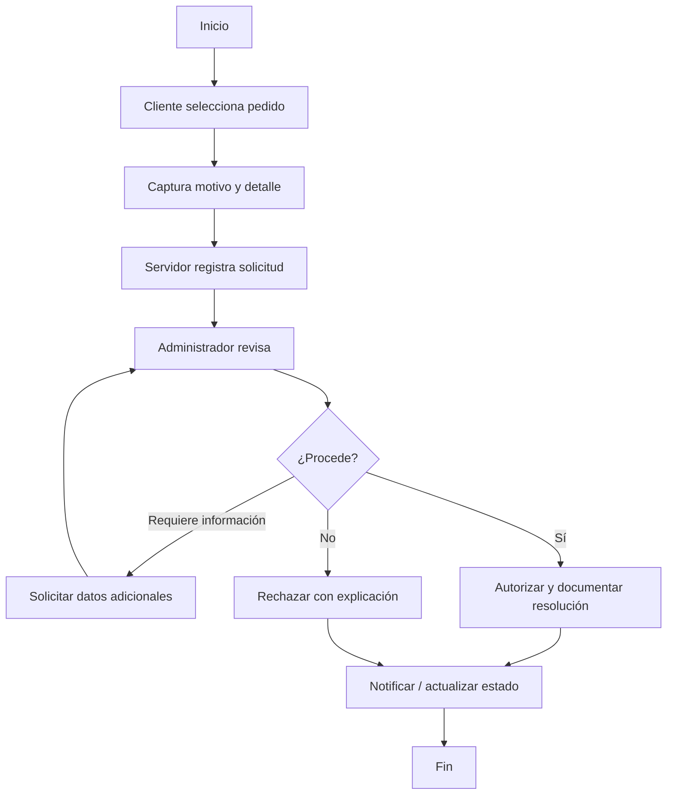
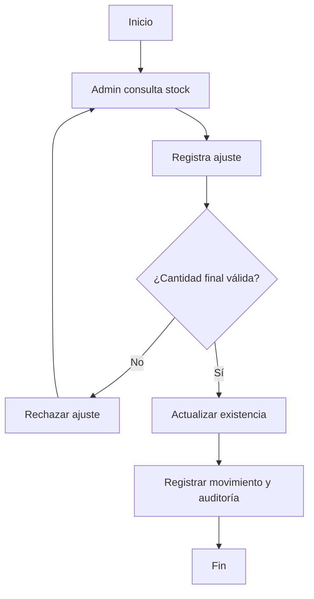

# Acta, backlog, diagramas y organización

## Acta de constitución (plantilla académica)
**Proyecto:** StepStyle — tienda virtual de calzado.  
**Propósito:** demostrar el diseño y desarrollo de una tienda de extremo a extremo.  
**Alcance:** catálogo, carrito, registro/login, checkout simulado, pedidos, inventario, panel administrativo, devoluciones, políticas y documentación.  
**Fuera de alcance:** cobros reales, logística física, CFDI, recuperación de contraseña por correo y operación comercial real.  
**Restricciones:** tiempo académico, recursos de prueba y necesidad de desplegar backend Node con almacenamiento persistente.  
**Criterio de éxito:** recorrer una compra de prueba, consultar pedido en administración, validar inventario, demostrar acceso por roles y presentar manuales y pruebas.  
**Equipo y aprobaciones:** completar nombres, roles y firmas del equipo.

## Backlog priorizado
| Prioridad | Historia | Criterio de aceptación |
|---|---|---|
| Alta | Como visitante busco productos | Búsqueda y filtros muestran coincidencias |
| Alta | Como comprador agrego al carrito | El subtotal y cantidades cambian |
| Alta | Como comprador confirmo pedido | El servidor genera folio y descuenta stock |
| Alta | Como admin gestiono pedidos | Solo rol admin accede y cambia estados |
| Alta | Como admin ajusto inventario | Existencias no negativas y movimiento registrado |
| Media | Como comprador solicito devolución | Se genera registro con estado |
| Media | Como admin reviso devoluciones | Puede cambiar estado y resolución |
| Media | Como comprador consulto historial | Ve sus propios pedidos |
| Media | Como equipo respaldo datos | Puede restaurar DB y verificarla |

## Registro inicial de riesgos
| Riesgo | Probabilidad | Impacto | Mitigación |
|---|---|---|---|
| Backend no disponible en GitHub Pages | Alta | Alto | Desplegar Node por separado o ejecutar local |
| Pérdida de archivo SQLite | Media | Alto | Respaldo periódico y restauración probada |
| Credenciales publicadas | Media | Alto | `.env` ignorado y secretos rotados |
| Stock desactualizado en cliente | Media | Medio | Validación definitiva en API |
| Imágenes externas no disponibles | Media | Medio | Revisar fuentes/licencias y mantener alternativas |
| Políticas académicas interpretadas como legales definitivas | Media | Alto | Marcar demo y revisar antes de vender |

## Matriz RACI (completar nombres)
| Actividad | Responsable | Aprobador | Consultado | Informado |
|---|---|---|---|---|
| Frontend | Integrante asignado | Líder | Equipo | Docente |
| API y BD | Integrante asignado | Líder | Equipo | Docente |
| Legal y documentación | Integrante asignado | Líder | Equipo | Docente |
| Pruebas y presentación | Todo el equipo | Líder | Docente | Equipo |

## Diagrama de casos de uso

## Actividad: compra

## Actividad: devolución

## Actividad: inventario

